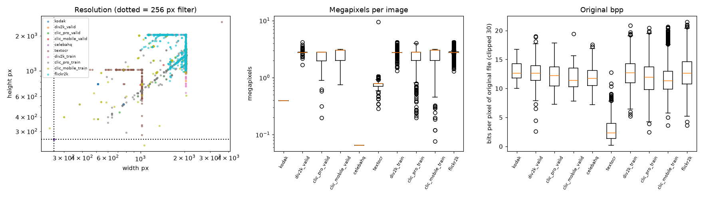
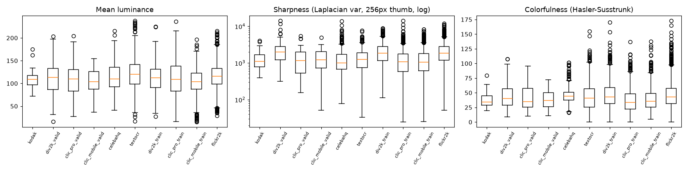
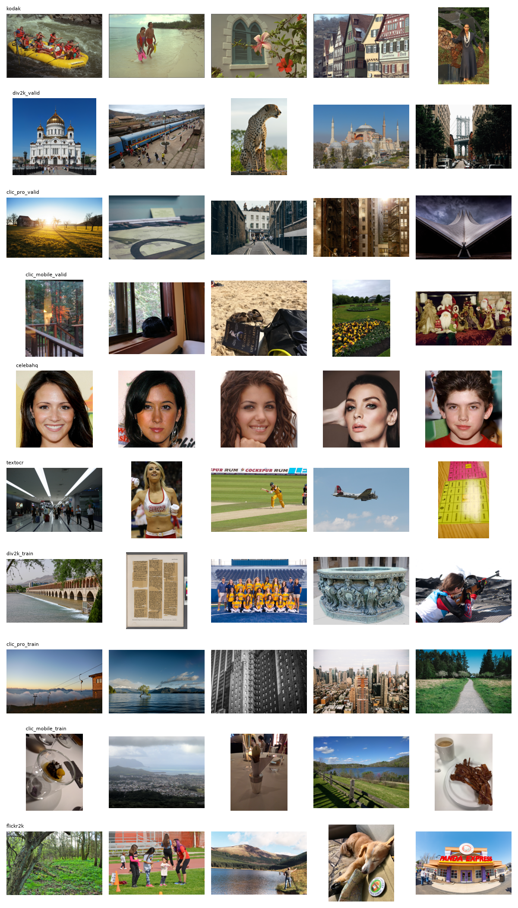
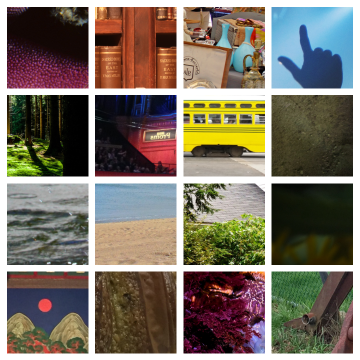

# TrueSight dataset report

Generated by `python scripts/prepare_data.py --stage prepare`.

## Split sizes

| split | images | content |
|---|---|---|
| train | 4909 | DIV2K train + Flickr2K + CLIC train (filtered, de-duplicated) |
| val | 100 | DIV2K valid |
| test_kodak | 24 | Kodak PhotoCD |
| test_clic | 102 | CLIC 2020 valid (professional + mobile), stand-in for the non-public test split |
| test_text | 500 | TextOCR scene-text images |
| test_face | 500 | CelebA-HQ faces |

## Done criteria

- At least 3,000 training images: **PASS** (4909)
- No test/val image in the training list (exact path + pHash<=4): **PASS** `{'train&val': 0, 'train&test_kodak': 0, 'train&test_clic': 0, 'train&test_text': 0, 'train&test_face': 0}`

## Filtering and de-duplication

```
{
  "dropped": {
    "val_small": 0,
    "val_gray": 0,
    "val_dup_of_held_out": 0,
    "val_dup_internal": 0,
    "train_small": 2,
    "train_gray": 32,
    "train_dup_of_held_out": 14,
    "train_dup_internal": 126
  },
  "corrupt": 0,
  "val_before": 100,
  "val_after": 100,
  "train_before": 5083,
  "train_after": 4909
}
```

## Per-dataset statistics

| dataset | images | width_min_med_max | height_min_med_max | megapixels_mean | portrait_pct | orig_bpp_median | luminance_mean | colorfulness_mean | grayscale | below_256px |
|---|---|---|---|---|---|---|---|---|---|---|
| celebahq | 500 | [256, 256, 256] | [256, 256, 256] | 0.07 | 0.0 | 11.76 | 113.8 | 45.5 | 0 | 0 |
| clic_mobile_train | 1048 | [240, 2000, 2048] | [228, 1512, 2048] | 2.62 | 34.1 | 11.31 | 104.6 | 38.8 | 0 | 2 |
| clic_mobile_valid | 61 | [996, 1632, 2048] | [756, 1512, 2048] | 2.63 | 34.4 | 11.36 | 104.5 | 37.8 | 0 | 0 |
| clic_pro_train | 585 | [384, 2048, 2048] | [294, 1361, 2048] | 2.33 | 6.3 | 11.93 | 110.7 | 36.7 | 25 | 0 |
| clic_pro_valid | 41 | [512, 2048, 2048] | [384, 1360, 1725] | 2.23 | 2.4 | 12.19 | 111.8 | 39.8 | 0 | 0 |
| div2k_train | 800 | [1116, 2040, 2040] | [648, 1356, 2040] | 2.79 | 10.9 | 12.68 | 111.3 | 46.7 | 4 | 0 |
| div2k_valid | 100 | [1356, 2040, 2040] | [816, 1356, 2040] | 2.84 | 10.0 | 12.6 | 109.0 | 44.1 | 0 | 0 |
| flickr2k | 2650 | [1020, 2040, 2040] | [816, 1356, 2040] | 2.76 | 13.1 | 12.6 | 115.3 | 46.6 | 3 | 0 |
| kodak | 24 | [512, 768, 768] | [512, 512, 768] | 0.39 | 25.0 | 12.61 | 110.4 | 39.2 | 0 | 0 |
| textocr | 500 | [419, 1024, 3585] | [280, 768, 2625] | 0.79 | 20.4 | 2.35 | 122.6 | 44.0 | 10 | 0 |

## Figures





